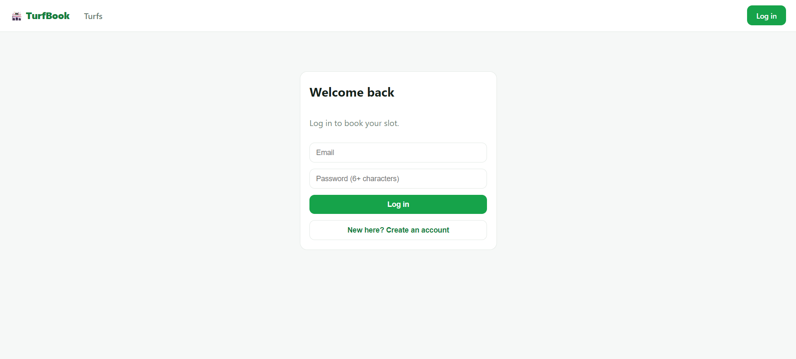
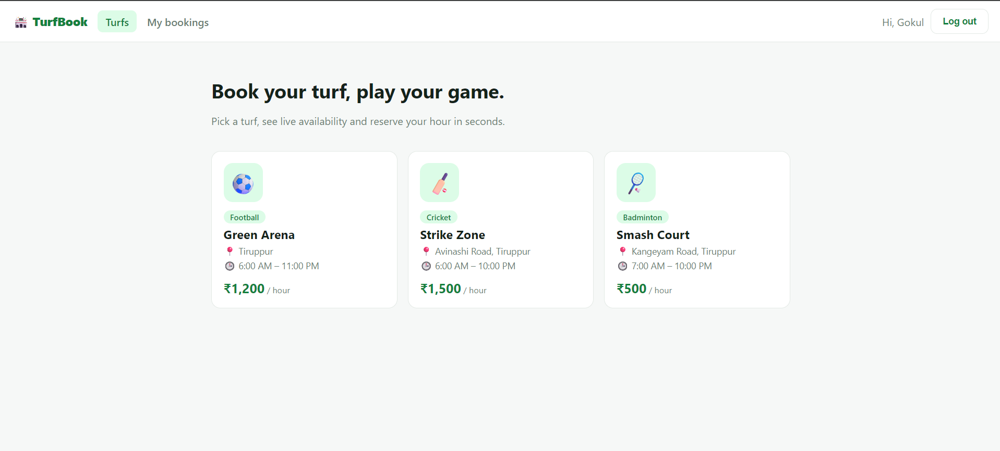
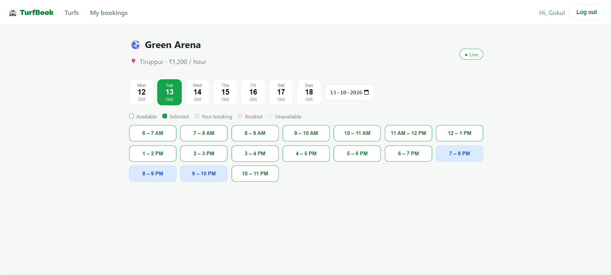
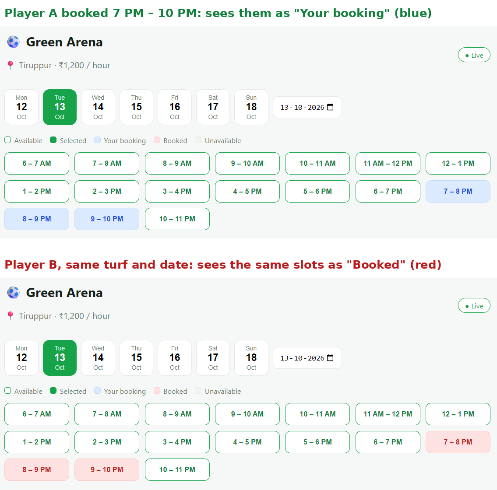
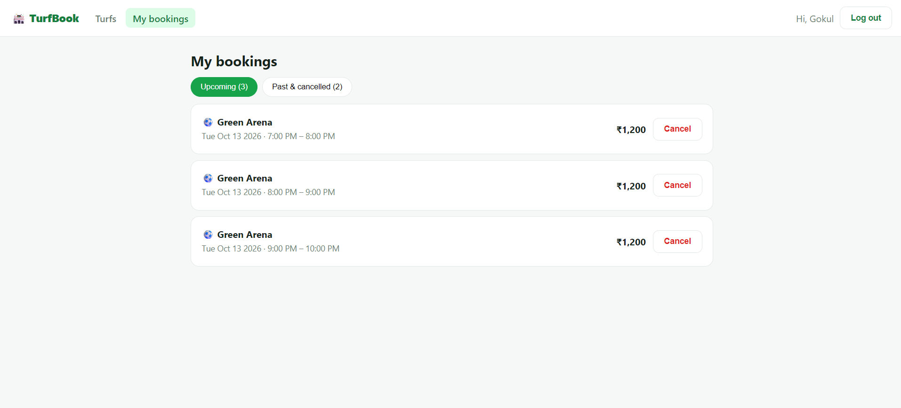
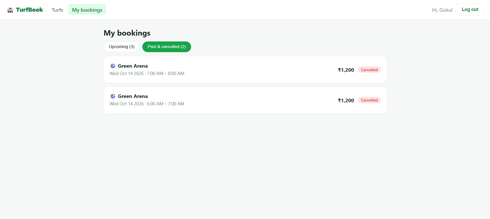
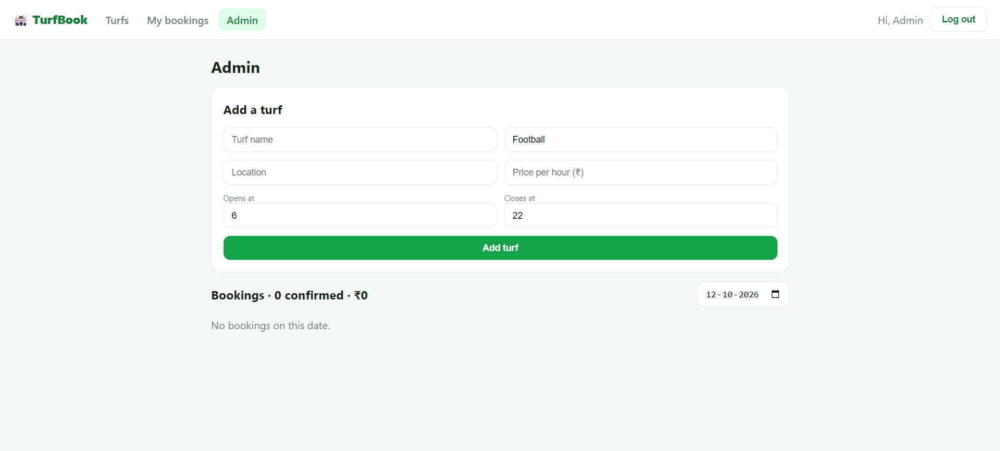

# TurfBook – Realtime Turf Booking Platform

Players browse turfs, see live slot availability and book hourly slots. When someone books or cancels, every other user viewing the same turf and date sees the slot change **instantly, without refreshing**.

**Live demo:** [turfbook-taupe.vercel.app](https://turfbook-taupe.vercel.app) &nbsp;|&nbsp; **API:** [turfbook-api-r4l9.onrender.com](https://turfbook-api-r4l9.onrender.com/api/health)

> Register a player account to try it. Hosted on free tiers (Vercel, Render and Neon), so the first load after a quiet period can take up to ~30 seconds while the server wakes up.

## Screenshots

### Login


### Browse turfs


### Live slot grid
Slots are colour-coded: available, selected, your booking, booked and unavailable. Each slot shows the full hour it covers, and the summary bar shows the total before you confirm.



### One schedule, two users
The same turf and date as seen by two different players: slots that one player booked appear as "Your booking" for them and as "Booked" for everyone else. Changes are pushed to every open screen through WebSockets, so nobody needs to refresh.



### My bookings




### Admin panel


## Features
- **Realtime availability** using Socket.IO rooms per turf and date. If you have selected a slot and someone else books it, it is deselected with a notification
- **No double booking, guaranteed by the database:** a partial UNIQUE index on `(turf_id, booking_date, start_hour) WHERE status = 'confirmed'`. Multi-slot bookings are a single atomic INSERT (all or nothing), and a cancelled slot can be booked again
- Slot grid for each day, with past slots blocked using the venue's timezone
- Book up to 4 hours at a time, up to 30 days ahead (pay at the venue)
- My Bookings with upcoming, past and cancelled views, plus cancellation rules
- Role-based access: **player** and **admin** (add turfs, view and cancel bookings by date)
- JWT authentication, bcrypt password hashing, responsive UI with toast notifications
- Integration tests, including a concurrent-request race test and a WebSocket test

## Tech Stack
| Layer | Technologies |
|---|---|
| Frontend | React (Vite), React Router, Socket.IO client |
| Backend | Node.js, Express.js, Socket.IO |
| Database | PostgreSQL (node-postgres, raw SQL) |
| Auth | JWT, bcryptjs |
| Hosting | Vercel (frontend), Render (backend), Neon (database) |

## Architecture
`routes → controllers → services → PostgreSQL`, plus `middleware/` (auth, role guard, error handler that maps PostgreSQL errors to HTTP statuses) and `socket.js` (realtime rooms). Controllers emit a socket event after a successful booking or cancellation, and only public data (turf, date, hours, status) is broadcast.

## API
| Method | Endpoint | Access |
|---|---|---|
| POST | `/api/auth/register`, `/api/auth/login` | Public |
| GET | `/api/turfs`, `/api/turfs/:id` | Public |
| GET | `/api/turfs/:id/slots?date=YYYY-MM-DD` | Logged in |
| POST | `/api/bookings` `{turfId, date, hours: []}` | Logged in |
| GET | `/api/bookings/mine` | Logged in |
| DELETE | `/api/bookings/:id` | Owner or admin |
| POST | `/api/turfs` | Admin |
| GET | `/api/bookings?date=` | Admin |

**Socket events:** the client emits `join` / `leave` with `{turfId, date}`; the server emits `slot:update` with `{turfId, date, hours, status}`.

## Run Locally
1. Install Node.js 20+ and PostgreSQL. Create two databases: `turfbook` and `turfbook_test`.
2. Backend:
```bash
cd server
cp .env.example .env       # on Windows: copy .env.example .env
# fill DATABASE_URL, TEST_DATABASE_URL and JWT_SECRET
npm install
npm run migrate            # create tables
npm run seed               # demo admin and 3 turfs (set ADMIN_PASSWORD first)
npm test                   # optional: integration tests
npm run dev                # http://localhost:5000
```
3. Frontend (new terminal):
```bash
cd client
npm install
npm run dev                # http://localhost:5173
```

To see realtime in action, log in as two different users in two browser windows (one normal, one incognito), open the same turf and date, and book a slot in one of them.

Never commit your `.env` file. It is listed in `.gitignore`.

## Deployment
- **Database:** Neon (free PostgreSQL). Set `DB_SSL=true` and run `npm run migrate` and `npm run seed` against it
- **Backend:** Render (root directory `server`, build `npm install`, start `npm start`). Environment variables: `DATABASE_URL`, `DB_SSL`, `JWT_SECRET`, `CLIENT_URL`, `TURF_TZ`
- **Frontend:** Vercel (root directory `client`, `VITE_API_URL` set to the Render URL; `vercel.json` handles client-side routing)

## Limitations and Next Steps
- Payment is pay-at-venue; online payments (for example Razorpay) would be a natural next feature
- Free hosting sleeps when idle, and long-lived WebSocket connections can drop, so the client reconnects automatically and rejoins its room
- Possible additions: email or SMS confirmations, recurring bookings and owner dashboards with revenue reports

## Author
**Gokul P M**
[LinkedIn](https://www.linkedin.com/in/gokul-p-m135) · [GitHub](https://github.com/Gokul0678) · gokul.pm135@gmail.com
